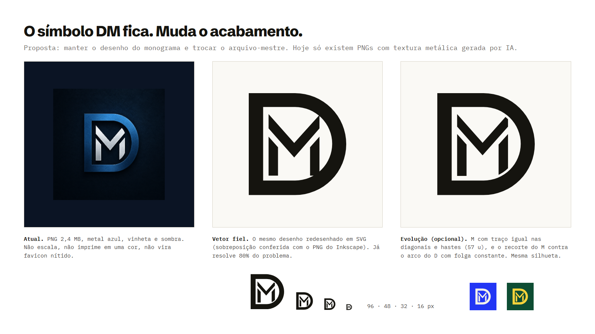
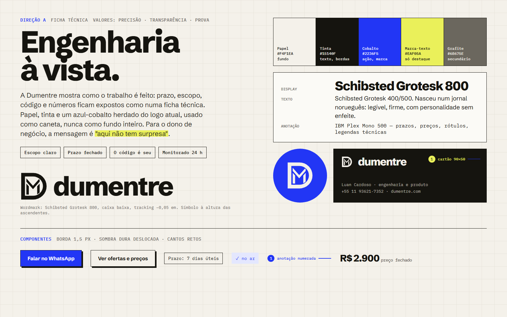
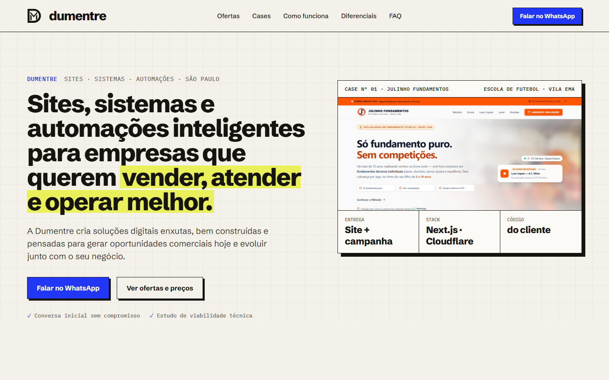
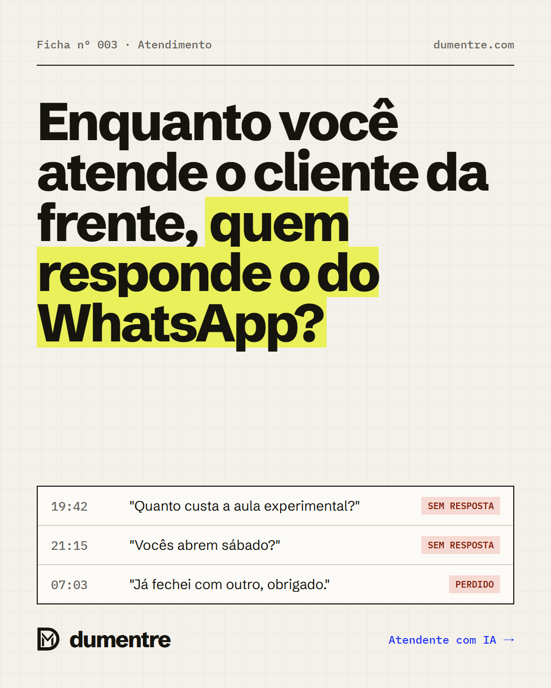
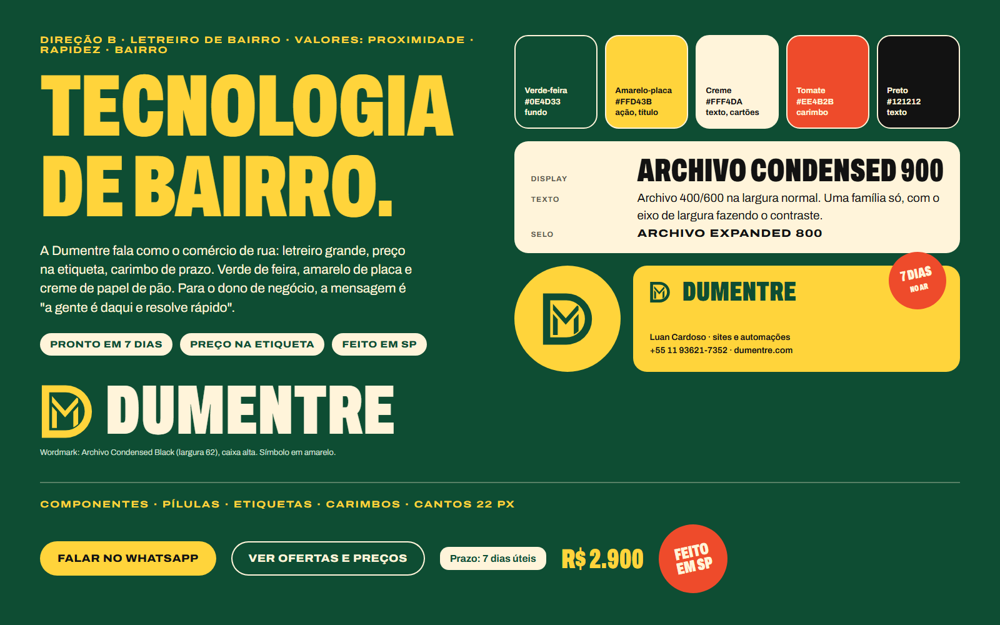
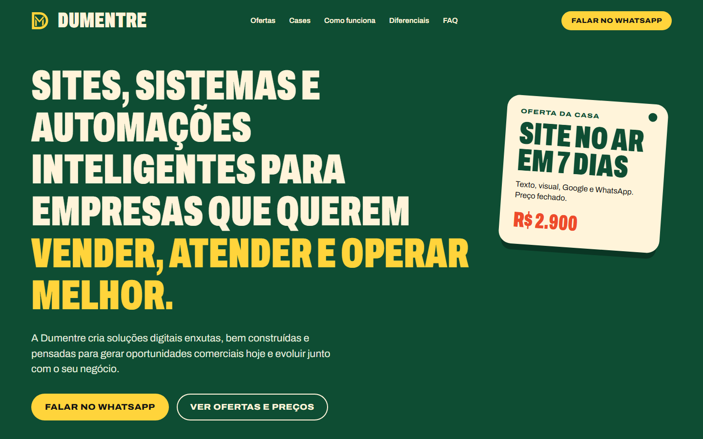

# Identidade visual — duas direções e recomendação

Feito com a skill `design-director`: estratégia antes do pixel, duas direções opostas, **mesmo texto nas duas** (hero do site atual e o mesmo post) para comparar só o visual, e crítica com o render real.

Abrir tudo de uma vez: [`direcoes.html`](direcoes.html) (local, abre direto no navegador).

## 0. Logo: o símbolo fica

- O monograma DM é bom: simples, memorável e legível até 32 px. **Não proponho redesenho.**
- O problema é o arquivo: só existem PNGs de 1,8 a 2,4 MB com metal e vinheta gerados por IA. Não há vetor.
- Entregue: [`marca/logo/simbolo-vetorizado-fiel.svg`](../../marca/logo/simbolo-vetorizado-fiel.svg) (mesmo desenho, conferido por sobreposição com o PNG do Inkscape) e [`marca/logo/simbolo.svg`](../../marca/logo/simbolo.svg), uma **evolução opcional**: o M ganha traço igual nas diagonais e hastes, e o recorte contra o arco do D passa a ter folga constante. Silhueta idêntica.
- Em 16 px o M some. Para favicon, ver backlog (versão simplificada só para tamanhos minúsculos).
- O wordmark muda com a direção (abaixo). O wordmark atual ("DUMENTRE" extendido) só existe em imagem.

## Estratégia comum (o que não muda entre as direções)

- **Para quem:** dono de pequeno e médio negócio em São Paulo (clínica, escolinha, escritório, comércio) que decide por WhatsApp.
- **Promessa:** tecnologia bem feita, com escopo e prazo fechados, que trabalha enquanto o dono atende.
- **Gancho de marca:** *Dumentre* vem do latim *dum interim*, "enquanto". Linha de assinatura sugerida: **"Enquanto você cuida do negócio, a gente cuida do digital."**
- **Território saturado da categoria:** azul-marinho/roxo com gradiente e neon (agências, SaaS, bancos) e, no extremo local, arte colorida de template. Ver [`marca/brand.md`](../../marca/brand.md).

## Direção A — Ficha Técnica (valores: precisão, transparência, prova)

| Tela do site | Post |
|---|---|
|  |  |

Papel, tinta, azul-cobalto (herdado do azul atual, usado como caneta) e marca-texto amarelo só para destacar. Schibsted Grotesk + IBM Plex Mono. Bordas finas, sombra dura deslocada e cantos retos. O gancho é a **ficha técnica**: prazo, stack, preço e status expostos como numa especificação.

## Direção B — Letreiro de Bairro (valores: proximidade, rapidez, bairro)

| Tela do site | Post |
|---|---|
|  |  |

Verde-feira, amarelo-placa, creme e carimbo tomate. Archivo Condensed Black em caixa alta. Pílulas, etiquetas de preço e carimbos. O gancho é o **comércio de rua**: preço na etiqueta, prazo no carimbo.

## Recomendação: **Direção A — Ficha Técnica**

1. **Combina com o que a Dumentre vende.** Os textos que o Luan aprovou já prometem "escopo claro, sem surpresas", "o código é seu" e "monitoramento ativo". A ficha técnica transforma essas promessas em visual. B vende rapidez e simpatia, que qualquer freelancer também promete.
2. **Diferencia nos dois lados.** Foge do azul-marinho com gradiente das agências e não se confunde com a arte colorida do comércio local, que é justamente o que a Dumentre produz para clientes. Em B, o portfólio (Julinho laranja, campanhas coloridas) disputaria atenção com a própria marca. Em A, o papel neutro serve de moldura para os cases.
3. **Continuidade.** Mantém o monograma e herda o azul. A troca não parece "outra empresa" para quem já viu o site.
4. **Escala para cima.** A mesma linguagem serve para a oferta de R$ 2.900 hoje e para os projetos de R$ 10–30 mil do posicionamento de arquiteto de sistemas (vault), sem rebrand.
5. **Risco de A:** ficar fria ou "técnica demais" para o dono de clínica. Mitigação: texto sempre na língua do cliente (os exemplos são conversas de WhatsApp, não jargão), fotos reais dos cases e o marca-texto como toque humano.

O que vale "roubar" de B sem misturar a identidade: o comportamento de **preço na etiqueta**, ou seja, ofertas com preço visível no site e nos posts. É uma decisão de conteúdo, não de visual.

## Crítica final (render real)

| Peça | Clareza | Posicionamento | Simplicidade | Acabamento |
|---|---|---|---|---|
| Logo (evolução) | 9 | 8 | 9 | 9 |
| A — prancha / site / post | 9 / 8 / 9 | 9 | 8 / 8 / 9 | 9 |
| B — prancha / site / post | 8 / 8 / 9 | 8 | 8 / 8 / 8 | 8 |

Correções feitas durante o loop: entrelinha de B abria colisão de acentos (Ç, Õ, Ê) → 0,93–1,0; H1 dos dois sites grande demais (7 linhas) → 58 px/86 px; callouts de A sobrepunham o título → removidos; bordas duplicadas na ficha do case → seletor corrigido; pranchas com área vazia → faixa de componentes.

Fonte de verdade da direção escolhida: [`marca/design.md`](../../marca/design.md).
