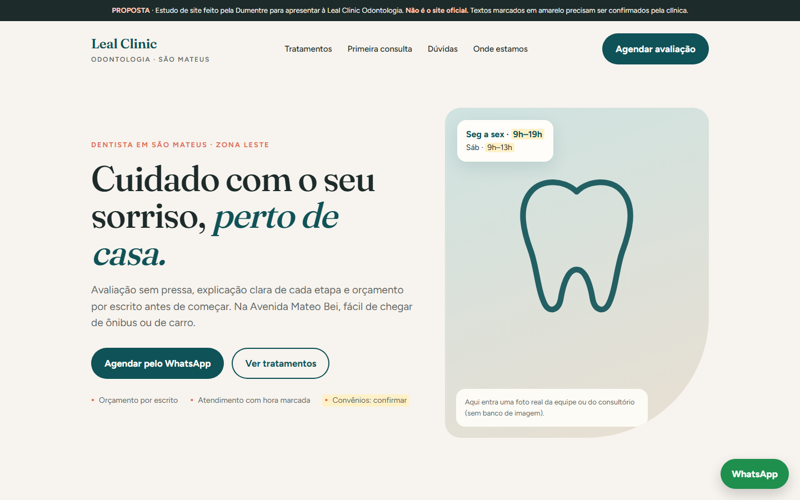
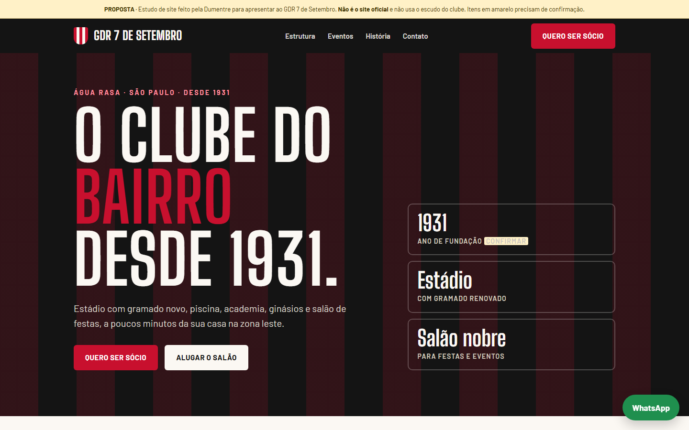
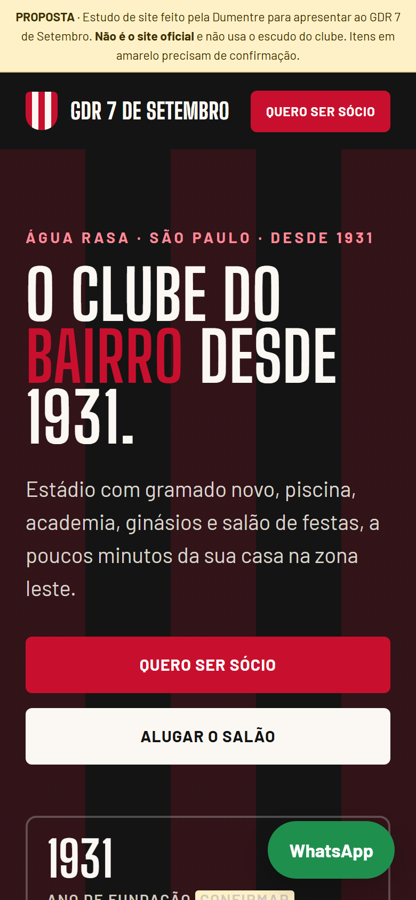

# Prospecção ativa

A prospecção vem **antes** dos anúncios: é grátis, valida qual oferta tem mais tração e gera os primeiros cases. Nada foi enviado; tudo aqui está pronto para o Luan disparar quando aprovar.

| Arquivo | O que tem |
|---|---|
| [prospects.md](prospects.md) | 20 negócios reais da zona leste com o problema verificado em 08/10/2026, prioridade, oferta de entrada e contato público, mais nichos com dor clara |
| [scripts-abordagem.md](scripts-abordagem.md) | WhatsApp, Instagram, e-mail, ligação, respostas rápidas e objeções |
| [mockups/leal-clinic/](mockups/leal-clinic/index.html) | Site-proposta da Leal Clinic Odontologia (São Mateus) |
| [mockups/gdr-7-de-setembro/](mockups/gdr-7-de-setembro/index.html) | Site-proposta do GDR 7 de Setembro (Água Rasa) |
| [evidencias/](evidencias/) | Prints, no celular, de como os sites atuais aparecem hoje |

## Sites-proposta ("sites prontos para oferecer")

| Leal Clinic Odontologia | GDR 7 de Setembro |
|---|---|
|  |  |
|  |  |
| Antes: página "Em breve" da Hostinger ([print](evidencias/leal.png)) | Antes: site em Flash, notícias de 2013 ([print](evidencias/gdr.png)) |

Como foram feitos para não enganar ninguém:
- Faixa fixa no topo: "PROPOSTA · Estudo feito pela Dumentre… **Não é o site oficial**".
- `noindex, nofollow`, arquivos locais, **não publicados**.
- Sem logo, escudo ou fotos dos negócios: o nome aparece só como texto, e os espaços de foto dizem "foto real entra aqui".
- Toda informação não confirmada (horário, convênio, valores, WhatsApp) está marcada em amarelo.
- Identidade visual própria para cada um (não é a cara da Dumentre): teal e areia com serifa Fraunces para a clínica; vermelho e preto com Big Shoulders para o clube.
- Mandar **print** ao prospect, não o arquivo. Se ele quiser ver navegando, publicar só depois do "ok" do Luan e com `noindex`.

Crítica (render real): Leal: clareza 9, posicionamento 8, simplicidade 9, acabamento 8. GDR: 9 / 9 / 8 / 8. Corrigido no loop: nota de foto cortada pela borda arredondada (Leal) e botão do topo quebrando em 2 linhas no celular (os dois).

## Cadência sugerida (2 semanas)

| Dia | Ação |
|---|---|
| D1 | Confirmar no Google Maps os 8 da prioridade A (aberto? telefone certo?) |
| D1–D2 | WhatsApp para os A (script 1 ou 3). Ligação para as 3 escolas (script 6) |
| D3–D5 | Prioridade B (scripts 1/2), Instagram para os C (script 4) |
| D6 | Lembrete único para quem não respondeu |
| D7–D10 | Raio-X para quem pediu; proposta para quem engajou |
| D10 | Balanço: respostas, Raio-X, propostas. Escolher o nicho com melhor resposta para a próxima lista de 20 |

Meta das 2 semanas: 20 contatos → 6 respostas → 3 Raio-X → 1 proposta fechada.
