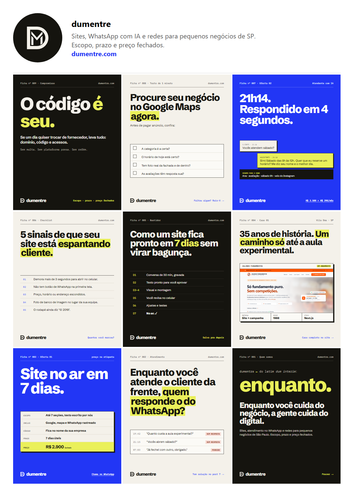

# Estratégia de redes — Instagram, Facebook e LinkedIn

Objetivo dos próximos 30 dias: **sair do zero com um perfil que vende sozinho quando o prospect clicar nele.** Nesta fase, a rede é prova e vitrine para a prospecção ativa ([prospecção](../prospeccao/README.md)), não canal de alcance. Ninguém fecha com uma empresa de tecnologia que tem 0 posts.

Nada aqui foi publicado. Artes: [`posts/`](posts/) (PNG 1080×1350 + fonte editável em [`posts.html`](posts/posts.html)).

## Pilares (e peso no calendário)

| Pilar | Peso | O que é | Exemplos |
|---|---|---|---|
| **Dor do dono** | 30% | Situações reais que fazem perder cliente | WhatsApp sem resposta às 21h, site que não abre no celular |
| **Prova** | 25% | Cases, bastidores, antes/depois, números | Case Julinho, "como um site fica pronto em 7 dias" |
| **Ensina rápido** | 20% | Testes de 1 minuto que o dono faz sozinho | Checklist do Google Maps, 5 sinais do site |
| **Oferta (preço na etiqueta)** | 15% | Oferta com escopo, prazo e preço | Site no Ar em 7 Dias, Atendente com IA, Raio-X |
| **Enquanto (marca e pessoa)** | 10% | Manifesto, quem faz, compromissos | "O código é seu", Luan apresentando a Dumentre |

## Papel de cada canal

| Canal | Papel | Ritmo | Formato |
|---|---|---|---|
| **Instagram** | Vitrine para o prospect e prova social local | 3 posts/semana (ter, qui, sáb) + stories em dias de post | Feed 4:5, carrossel quando houver passo a passo, stories com enquete e link para WhatsApp |
| **Facebook** | Alcance de donos de negócio 35+ do bairro e base para Meta Ads | Espelho do Instagram (publicação cruzada) | Mesmo post; participar de 3–5 grupos de bairro/comércio da zona leste e sul **sem spam** (responder dúvidas) |
| **LinkedIn** | Autoridade do Luan com decisores e contas maiores | 2 posts/semana no **perfil pessoal do Luan** + compartilhar na página | Texto em primeira pessoa com a arte como imagem; bastidores técnicos em linguagem simples |
| **WhatsApp Business** | Onde a venda acontece | — | Catálogo com as 4 ofertas, mensagem de saudação, respostas rápidas (ver [scripts](../prospeccao/scripts-abordagem.md)) |
| **Google (Perfil de Empresa)** | Busca local "criação de site + bairro" | 1 atualização/semana | Mesmo post como "Novidade"; fotos reais |

## Configuração dos perfis (antes do 1º post)

- **Handle:** o site aponta para **@dumentre.co**; o vault diz que **@dumentre** foi reservado. Usar um só nos dois lugares (decisão do Luan, ver backlog). Recomendo **@dumentre** se estiver na mesma conta.
- **Foto:** símbolo DM em papel sobre tinta (`dumentre-website-v2--redesign/android-chrome-512x512.png`).
- **Bio Instagram (150 caracteres):**
  > Sites, WhatsApp com IA e redes para pequenos negócios de SP.
  > Escopo, prazo e preço fechados.
  > 👇 Raio-X grátis do seu digital
- **Link:** `https://wa.me/5511936217352?text=Vim%20pelo%20Instagram%20e%20quero%20o%20Raio-X` (sem encurtador; troca para o site quando o redesign estiver no ar com UTM).
- **Destaques:** Ofertas · Case Julinho · Como funciona · Dúvidas. Capas: fundo tinta, palavra em mono amarela.
- **Facebook:** categoria "Serviço de design de sites"; mesmo texto da bio; botão "Enviar mensagem no WhatsApp".
- **LinkedIn (página):** tagline "Sites, atendimento com IA e redes para pequenos negócios. Escopo, prazo e preço fechados." Perfil do Luan: título "Engenheiro de software · fundador da Dumentre · sites e automações para pequenos negócios".

## Calendário de 30 dias (13/10 a 11/11/2026)

12/10 é feriado (Dia das Crianças / N. Sra. Aparecida). Começar na terça, 13/10. "IG/FB" = mesmo post nos dois. "LI" = post no perfil do Luan.

| Data | Canal | Pilar | Peça | Observação |
|---|---|---|---|---|
| ter 13/10 | IG/FB | Enquanto | **Post 1** — "enquanto." | Story: "a gente chegou" + enquete "seu WhatsApp responde à noite?" |
| ter 13/10 | LI | Enquanto | Texto de lançamento do Luan (abaixo) + post 1 | |
| qui 15/10 | IG/FB | Dor | **Post 2** — WhatsApp sem resposta | Story: caixa de pergunta "qual a pergunta que você mais responde?" |
| sáb 17/10 | IG/FB | Oferta | **Post 3** — Site no Ar em 7 Dias | Story com link para WhatsApp |
| seg 19/10 | LI | Prova | Bastidor: como o Luan usa IA para entregar em 7 dias (sem buzzword) | |
| ter 20/10 | IG/FB | Prova | **Post 4** — Case Julinho | **Só com autorização da escola**; se não houver, trocar pelo post 6 e adiar |
| qui 22/10 | IG/FB | Prova | **Post 5** — 7 dias, dia a dia | |
| sex 23/10 | LI | Dor | "O que eu vi analisando 20 sites de negócios da zona leste" (dados da prospecção, sem nomear ninguém) | |
| sáb 24/10 | IG/FB | Ensina | **Post 6** — 5 sinais | Story: enquete "quantos você marcou?" |
| ter 27/10 | IG/FB | Oferta | **Post 7** — Atendente com IA | |
| qua 28/10 | LI | Oferta | Atendente com IA explicado para dono de negócio | |
| qui 29/10 | IG/FB | Ensina | **Post 8** — teste do Google Maps | |
| sáb 31/10 | IG/FB | Enquanto | **Post 9** — O código é seu | |
| ter 03/11 | IG/FB | Prova | Carrossel "Raio-X de um site real" (prospect que autorizar, ou site fictício) | Produzir com o template dos posts |
| qua 04/11 | LI | Prova | Primeiros resultados: quantos Raio-X, o que mais aparece | |
| qui 05/11 | IG/FB | Oferta | Raio-X Digital (R$ 390 abatível) | |
| sáb 07/11 | IG/FB | Dor | "Black Friday chegando: seu WhatsApp aguenta?" | Gancho para Campanha Pronta |
| seg 09/11 | LI | Enquanto | Por que preço na etiqueta (opinião do Luan) | |
| ter 10/11 | IG/FB | Oferta | Campanha Pronta para Black Friday/Natal | Prazo de venda: até 13/11 para entregar antes de 27/11 |
| qua 11/11 | IG/FB/LI | Prova | Balanço do mês + depoimento do primeiro cliente (se houver) | |

Stories diários nos dias sem post são opcionais; o essencial é ter **destaques prontos** para quem chega pela prospecção.

**Métricas do mês** (anotar toda segunda no backlog): seguidores, visitas ao perfil, cliques no link, conversas no WhatsApp com origem "Instagram", Raio-X pedidos. A meta não é alcance: é **5 conversas iniciadas pelas redes** e o perfil servir de prova em 100% das abordagens.

---

## Legendas dos 9 posts

Hashtags: poucas e locais. Instagram ≤ 5. Sem emoji em excesso (ver [voz](../../marca/voice_principles.md)).

### Post 1 — "enquanto." · [arte](posts/post-01.png)
> Dumentre vem do latim *dum interim*: enquanto.
>
> É exatamente o que a gente faz. Enquanto você atende, vende e resolve o dia a dia, a gente cuida do site, do Google e do WhatsApp da sua empresa.
>
> Somos de São Paulo e trabalhamos com pequenos negócios: clínicas, escolas, escritórios e comércio. Tudo com escopo, prazo e preço fechados antes de começar. Sem surpresa no meio do caminho.
>
> Nos próximos posts você vai ver como a gente trabalha, quanto custa e o que já fizemos.
>
> #pequenosnegocios #saopaulo #sitesprofissionais #whatsappbusiness

### Post 2 — WhatsApp sem resposta · [arte](posts/post-02.png)
> 19h42: "Quanto custa?"
> 21h15: "Vocês abrem sábado?"
> 07h03: "Já fechei com outro, obrigado."
>
> Não foi falta de interesse. Foi falta de resposta enquanto você estava atendendo quem estava na sua frente.
>
> Quem compra pelo WhatsApp costuma chamar mais de uma empresa ao mesmo tempo. Quem responde primeiro, na maioria das vezes, leva.
>
> Isso tem solução sem contratar mais ninguém. Mostramos como no post 7.
>
> #whatsappbusiness #atendimento #pequenosnegocios #saopaulo

### Post 3 — Site no Ar em 7 Dias · [arte](posts/post-03.png)
> Preço na etiqueta, porque você merece saber antes de perguntar.
>
> Site no Ar em 7 Dias, R$ 2.900:
> ✓ até 7 seções, com o texto escrito por nós
> ✓ aparece no Google, com mapa
> ✓ botão de WhatsApp que mostra de onde veio cada cliente
> ✓ domínio e código no nome da sua empresa
> ✓ 30 dias de garantia de ajustes
>
> Prazo: 7 dias úteis a partir da nossa conversa de 30 minutos. 50% para começar, 50% na entrega.
>
> Chama no WhatsApp pelo link da bio.
>
> #criacaodesites #sitesprofissionais #pequenosnegocios #saopaulo

### Post 4 — Case Julinho · [arte](posts/post-04.png) — **publicar só com autorização da escola**
> Case 01: Julinho Fundamentos, escola de futebol e futsal na Vila Ema desde 1988.
>
> O desafio: 35 anos de história espalhados entre site antigo, Instagram e matérias, e quem se interessava caía direto no WhatsApp, sem saber idade, horário ou como funciona a aula.
>
> O que fizemos: site novo com a história, o método e a avaliação em destaque, e uma campanha visual para o Dia das Crianças com duas opções de estilo para a escola escolher.
>
> O projeto está em validação com a escola. Quando houver números de matrícula, eles aparecem aqui.
>
> (Fotos de alunos desfocadas de propósito: imagem de criança só com autorização.)
>
> #vilaema #zonaleste #escoladefutebol #criacaodesites

### Post 5 — 7 dias, dia a dia · [arte](posts/post-05.png)
> "Site em 7 dias" parece promessa de vendedor. Então aqui está o dia a dia:
>
> D1: conversa de 30 minutos (gravada, para não esquecer nada)
> D2: texto pronto para você aprovar
> D3–D4: visual e montagem
> D5: você revisa pelo celular
> D6: ajustes e testes
> D7: no ar
>
> O segredo não é correr. É não ter idas e vindas: escopo fechado no D1 e só 2 rodadas de ajuste.
>
> Salva para quando for a sua vez.
>
> #criacaodesites #pequenosnegocios #empreendedorismo

### Post 6 — 5 sinais · [arte](posts/post-06.png)
> Abre o seu site no celular agora e confere:
>
> 1. Demora mais de 3 segundos para abrir?
> 2. Não tem botão de WhatsApp na primeira tela?
> 3. Preço, horário ou endereço estão escondidos?
> 4. As fotos são de banco de imagem?
> 5. O rodapé ainda diz © 2019?
>
> Marcou 2 ou mais? Seu site pode estar espantando cliente que já tinha decidido comprar.
>
> Manda "RAIO-X" no WhatsApp que a gente olha o seu de graça e devolve os 3 principais pontos.
>
> #sitesprofissionais #marketinglocal #pequenosnegocios #saopaulo

### Post 7 — Atendente com IA · [arte](posts/post-07.png)
> 21h14. Cliente pergunta se você atende sábado.
> 21h14. Já recebeu a resposta, o horário e o pedido do nome.
> Você recebe só o resumo: quem é, o que quer e quando.
>
> É o Atendente de WhatsApp com IA da Dumentre:
> ✓ responde as perguntas que você já responde todo dia
> ✓ separa quem quer comprar
> ✓ passa para você com o resumo pronto
> ✓ registra tudo numa planilha
>
> Você continua no comando: a IA faz a triagem, quem fecha é você.
>
> Implantação R$ 3.500 + R$ 390/mês. Custos da API oficial do WhatsApp são repassados sem margem e informados antes.
>
> #whatsappbusiness #inteligenciaartificial #atendimento #pequenosnegocios

### Post 8 — teste do Google Maps · [arte](posts/post-08.png)
> Teste de 1 minuto antes de gastar com anúncio: procure o nome do seu negócio no Google Maps.
>
> ☐ A categoria está certa?
> ☐ O horário de hoje está certo?
> ☐ Tem foto real da fachada e de dentro?
> ☐ As avaliações têm resposta sua?
>
> O Perfil de Empresa no Google é gratuito e, para negócio de bairro, costuma trazer mais cliente que site. Faltou algum item? Pede o Raio-X pelo link da bio.
>
> #googlemeunegocio #marketinglocal #pequenosnegocios #saopaulo

### Post 9 — O código é seu · [arte](posts/post-09.png)
> O código é seu.
>
> Parece detalhe, mas não é. Muita empresa descobre na hora de trocar de fornecedor que o site, o domínio ou o robô do WhatsApp estavam no nome de outra pessoa.
>
> Aqui, desde o primeiro dia: domínio no seu nome, código entregue, acessos com você. Se um dia quiser seguir com outra equipe, leva tudo. Sem multa, sem refém.
>
> #pequenosnegocios #transparencia #sitesprofissionais

---

## Texto de lançamento no LinkedIn (perfil do Luan, 13/10)

> Depois de alguns anos construindo produto digital para empresa grande (app nas lojas, APIs, automações), resolvi colocar a mesma engenharia no tamanho de quem mais precisa e menos tem acesso: o pequeno negócio.
>
> A Dumentre faz três coisas, com escopo, prazo e preço fechados:
> → site no ar em 7 dias (R$ 2.900)
> → atendente de WhatsApp com IA, que responde às 21h e me passa só o resumo
> → campanha pronta para o seu lançamento, promoção ou matrícula
>
> O nome vem do latim *dum interim*: enquanto. Enquanto o dono cuida do negócio, a gente cuida do digital.
>
> Se você conhece alguém com o WhatsApp lotado e o site parado em 2019, me apresenta. Eu faço um Raio-X de graça.

Revisar com o Luan: o texto não cita o empregador atual; confirmar se ele quer mencionar a experiência dessa forma.
