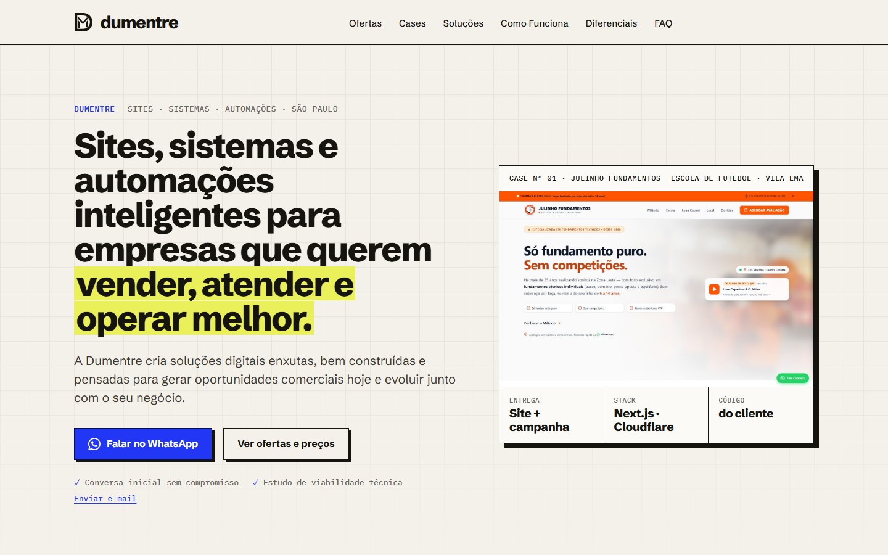
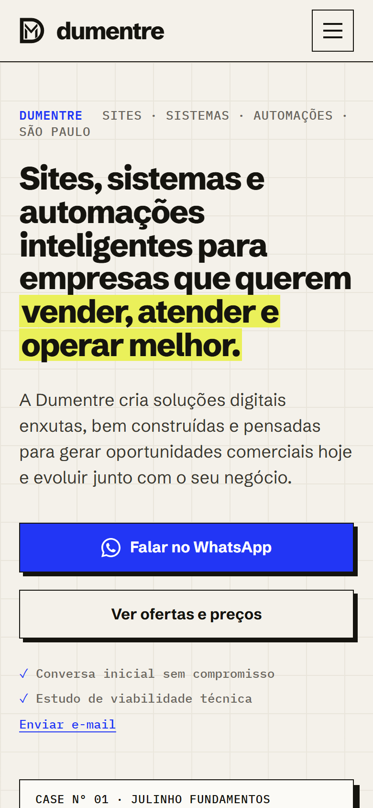
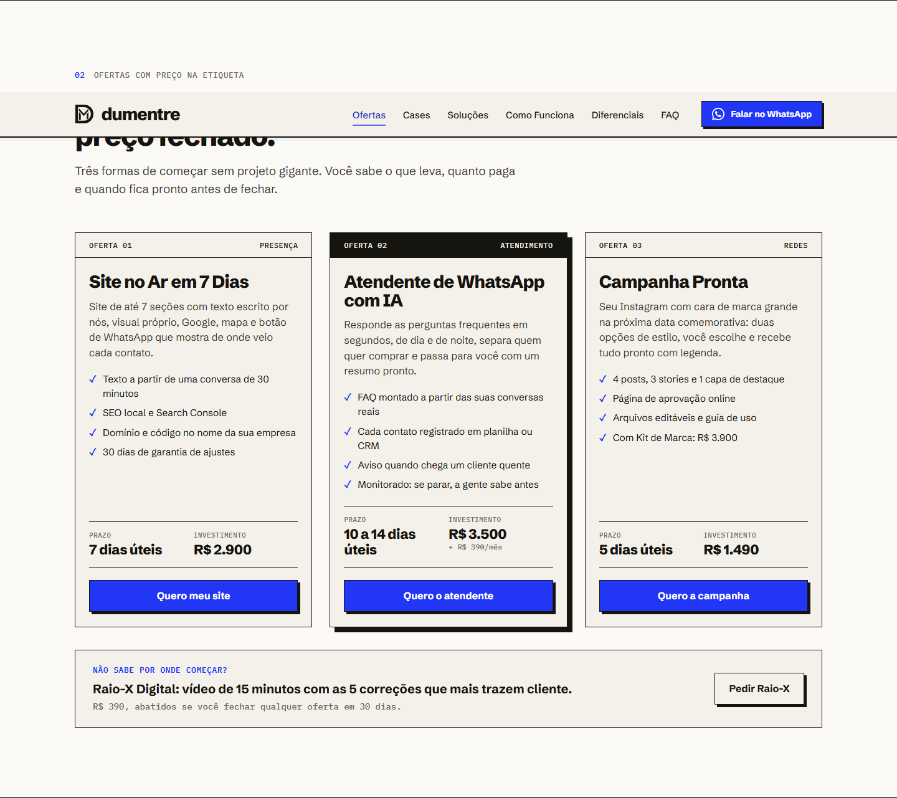
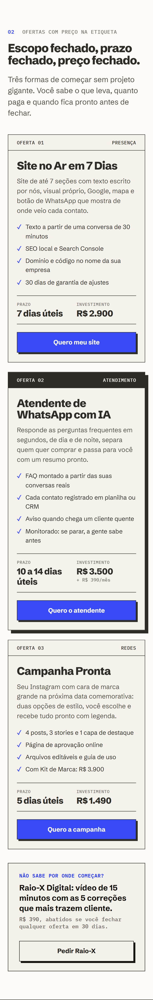
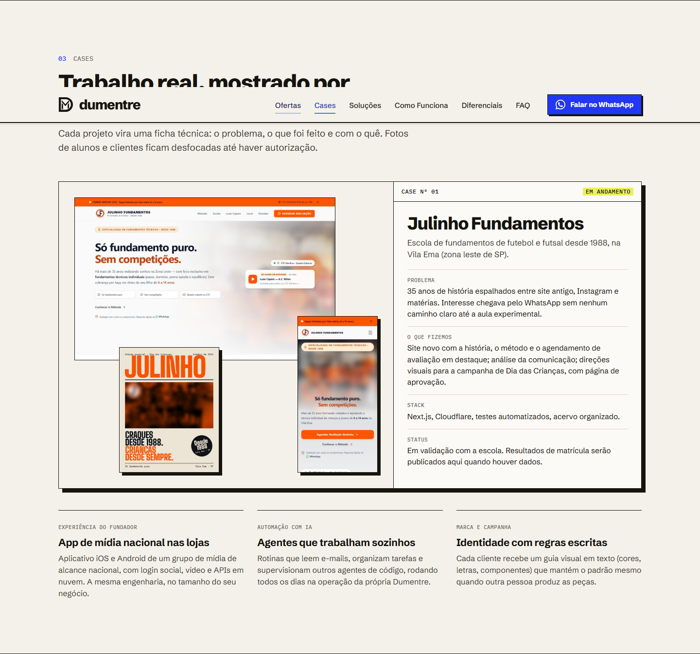
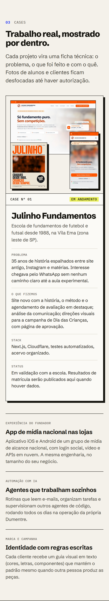

# Site novo — branch `redesign/identidade-2026-10`

- **Onde está o código:** worktree `C:\Users\luanc\projects\dumentre\dumentre-website-v2--redesign` (branch `redesign/identidade-2026-10`, commit local `dba242e`). **Sem push.**
- **Por que worktree:** o checkout principal (`dumentre-website-v2`, branch `main`) tem trabalho não commitado do Luan (rastreamento de cliques no WhatsApp com UTM/`dataLayer`). Ele ficou intacto. Os CTAs novos já têm `data-service`/`data-cta-position`, compatíveis com esse script quando ele entrar.
- **Rodar local:** `cd dumentre-website-v2--redesign && npm run build && python -m http.server 8800 -d dist` → http://localhost:8800
- **Testes:** `npm run test:e2e` → 102 passaram, 0 falharam (24 pulados por viewport), em 08/10/2026.

## O que mudou

| Item | Antes | Depois |
|---|---|---|
| Visual | azul-marinho, gradiente, badges coloridos, mockup de janela | direção A "Ficha Técnica" ([design.md](../../marca/design.md)) |
| Textos | — | **mantidos** (hero, problemas, soluções, comece pequeno, como funciona, diferenciais, para quem, FAQ, CTA final) |
| Novas seções | — | faixa "enquanto" (manifesto), **Ofertas** com preço e prazo, **Cases** (Julinho + provas de capacidade) |
| Navegação | Problemas, Soluções, Comece Pequeno, Como Funciona, Diferenciais, FAQ | Ofertas, Cases, Soluções, Como Funciona, Diferenciais, FAQ (Problemas e Comece Pequeno seguem no rodapé) |
| CTA secundário do hero | "Enviar e-mail" | "Ver ofertas e preços" (e-mail virou link de texto logo abaixo) |
| Logo | PNG com metal | SVG do símbolo + wordmark em texto |
| Favicons, OG | PNG do logo | gerados do SVG por `scripts/generate-brand-assets.js`; OG com a assinatura "Enquanto você cuida do negócio…" |

## Prints

| Desktop | Celular |
|---|---|
|  |  |
|  |  |
|  |  |
| [página inteira](desktop-full.jpg) | [página inteira](mobile-full.jpg) · [menu aberto](mobile-menu-aberto.png) |

## Crítica (render real, design-director)

| Critério | Nota | Observação |
|---|---|---|
| Clareza / ergonomia | 9 | Botões com borda e sombra dura parecem clicáveis; "afundam" no hover/clique; menu mobile em tela cheia com alvos de 56 px |
| Posicionamento | 9 | Sai do azul-marinho da categoria; ofertas com preço visível são raras no segmento |
| Simplicidade | 8 | Página longa (14 seções). Próximo corte sugerido: fundir "Soluções" e "Comece pequeno" depois de validar as ofertas |
| Acabamento | 8 | Tipografia e contraste AA conferidos. Pendente: favicon simplificado para 16 px |

Correções do loop: título do hero de 7 para 5–6 linhas (desktop e celular); eyebrow quebrando em duas linhas no celular; painel do menu mobile sobrepondo a borda do header (pego pelo teste de WebKit).

## Antes de publicar (decisões do Luan)

1. Aprovar a direção A e os preços exibidos (ver [backlog](../../backlog/README.md)).
2. **Autorização da Julinho Fundamentos** para usar o case (projeto pro bono; site e campanha ainda não aprovados pela escola).
3. Commitar o trabalho de rastreamento que está em `main` e fazer o merge desta branch por cima.
4. E-mail em domínio próprio (`contato@dumentre.com`) antes de divulgar.
