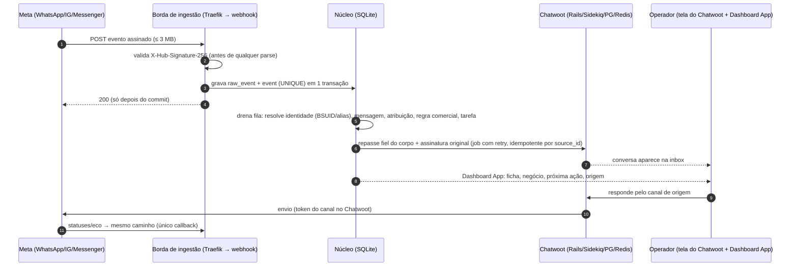
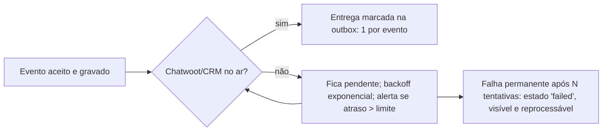

# Design: atendimento omnichannel, CRM, atribuição, follow-up e billing da Dumentre

Estado: **proposta de planejamento, nada implementado**. Evidência e fontes em `research/` (índice em `research/00-progresso.md`; fontes em `research/10-fontes.md`). Onde este documento diz "provado", significa **executado contra mock ou fixture** (P0/P1/P2), nunca contra Chatwoot nem Meta reais.

## 1. Decisão recomendada

**H4: Chatwoot Community (caixa e tela principal) + Núcleo Dumentre pequeno (borda de ingestão, identidade, ficha, funil mínimo, follow-up, atribuição, billing interno) + painel embutido (Dashboard App).** Sem CRM de terceiros na primeira fase.

| Componente | Uso | Por quê | Se falhar |
|---|---|---|---|
| **Chatwoot Community v4.20.1** (MIT; versão fixada e reavaliada a cada atualização) | **usado diretamente**: recepção e envio de WhatsApp, Instagram, Messenger, e-mail, Telegram, site, (TikTok condicional), anexos, status, equipe | entrega os canais sem reescrevê-los; edição livre cobre o necessário (`research/03`) | borda continua guardando eventos; operador perde a tela até restaurar (AT-10) |
| **Borda de ingestão** = evolução do `whatsapp-business-mcp/src/webhook-service.js` | **integrada/desenvolvida**: único destino do callback da Meta; valida assinatura; grava payload bruto + eventos; responde 200 só depois de persistir; repassa fielmente ao Chatwoot com retry; extrai atribuição | resolve "um callback por app", perda de webhook do Chatwoot, `referral` de IG/Messenger e BSUID | eventos ficam em fila durável até a Meta (retry 7 dias) ou nós reprocessarmos |
| **Núcleo Dumentre** (Node 22, SQLite WAL) | **desenvolvido**: pessoa/empresa, identidades e vínculos, negócio/proposta/tarefa, política, atribuição, outbox, envio com política única, billing interno | é o diferencial pedido; protótipo P1 já exercita a lógica | Chatwoot e canais seguem; follow-up e funil param até reiniciar (estado em disco) |
| **Dashboard App** (iframe no Chatwoot) | **desenvolvido**: ficha, negócios, tarefas, atribuição, cobranças dentro da conversa | "tela principal" única | operador usa a página standalone do núcleo |
| PostgreSQL 16 + pgvector, Redis 7 | **usados** (exigência do Chatwoot) | | |
| Traefik, NetBird, OpenBao | **existentes**, inalterados | | |
| Frappe CRM / ERPNext / Woofed / Twenty / EspoCRM | **adiados/descartados** (`research/03`) | segundo cadastro de pessoas, RAM, manutenção | contingência C2 |
| IA (resumo, transcrição, extração) | **adiada** para a F6, desligada por padrão | fluxo principal independe dela (AT-13) | |
| MCP somente leitura | **adiado** para a F6, fora do caminho crítico | consulta a ficha por Claude/Codex/Hermes | |
| Meta Business Agent | **fora do desenho** | custo por token, troca o controlador da conversa | |

### Alternativas descartadas (resumo)
H1 Chatwoot + ERPNext (dois cadastros, RAM, NFS-e fora); H2 Chatwoot + Frappe CRM (operador alterna telas, RAM); H3 Chatwoot + Woofed (projeto pequeno e parado há 3 meses); H5 só UI própria sem Chatwoot (reimplementar 6 canais); H6 SaaS (viola a restrição). Detalhe e números em `research/03-alternativas-stack.md`. **Contingências:** C1 (núcleo + UI própria só para WhatsApp/IG/Messenger) e C2 (segunda VM), com condições de acionamento concretas.

### Portão G-CAP (antes de qualquer migração)
Com Chatwoot + Postgres + Redis + núcleo ativos no VPS e carga sintética: `MemAvailable` ≥ 800 MiB, zero reinício por OOM dos serviços existentes, p95 do webhook < 1 s, picos de atualização e backup incluídos, limites de memória por container e swap de 1 a 2 GB. **Não medido.** Vermelho → C1 ou C2 (decisão D2).

## 2. Fluxo principal (entrada → histórico → contato/lead → próxima ação → UI)

Regra de ouro: **só a borda recebe da Meta; só o Chatwoot envia pelo canal de conversa; só o núcleo decide regras comerciais, vínculos e follow-up.** Nunca duas integrações responsáveis pelo mesmo envio ou evento.

### Falha temporária do destino (AT-10)

Depois de aceitar um evento, ele **sempre** pode ser reprocessado a partir do `raw_event`. Mensagens e identidade continuam sendo gravadas mesmo com o Chatwoot fora.

### Envio com timeout ambíguo (AT-06)
`send()` reserva orçamento e idempotência **antes** de chamar o provedor; `ETIMEDOUT`/`ECONNRESET` → estado `incerto` e **nenhum reenvio** com a mesma chave; a UI mostra "incerto" até o eco ou o status resolverem. Status antigo ou fora de ordem nunca rebaixa o estado final (`read` > `delivered` > `sent`; `failed` só vale antes de `delivered`).

## 3. Fonte da verdade e persistência (quem guarda cada dado)

| Entidade | Fonte da verdade | Chave | Quem escreve | Quem lê | Projeções / cópias | Reconciliação |
|---|---|---|---|---|---|---|
| Evento bruto | **Núcleo** (`raw_event`) | SHA-256 do corpo; `(provedor, conta, dedupe_key)` por evento | só a borda | reprocessador, auditoria | nenhuma | retenção 90 dias (D4), depois reduz a metadados |
| Mensagem (conteúdo, anexo, entrega) | **Chatwoot** para a conversa mostrada; **núcleo** guarda só metadados (`ext_id`, direção, canal, horários, status, tipo) e referência | `(provedor, conta, id externo)` | Chatwoot (UI/canal) e núcleo (metadados) | operador, núcleo | metadados no núcleo | job de reconciliação compara contagem e último id por conversa; diverge → alerta, não corrige sozinho |
| Conversa, inbox, equipe, rótulos | **Chatwoot** | id do Chatwoot | operador | operador | — | — |
| **Identidade de canal** | **Núcleo** (`identity`, `identity_alias`) | `(provedor, conta, id externo)`; BSUID tem prioridade, telefone é alias | núcleo | todos | contato do Chatwoot (`source_id`) | divergência → núcleo vence; Chatwoot recebe atributo `dumentre_person_id` |
| Pessoa / empresa | **Núcleo** | `person_id` | operador (painel) e regras | todos | nome e atributos no contato do Chatwoot | |
| Vínculo identidade ↔ pessoa | **Núcleo** (`identity_link`, auditável) | id do vínculo | só com evidência + autor | todos | merge de contatos no Chatwoot (planejado) | reverter cria nova linha; nada é apagado |
| Oportunidade, proposta, tarefa, etapa | **Núcleo** | id | operador e regras | todos | contagem/etapa como atributo no contato (opcional) | |
| Atribuição | **Núcleo** (`attribution`: bruto + normalizado + status) | `event_id` | só a borda/regras | todos | `referral` do WhatsApp também no Chatwoot | etiqueta comercial **não** reescreve o bruto |
| Política (X dias, reabertura…) | **Núcleo** (`policy`, versionada) | chave | admin | núcleo | — | |
| Cobrança, pagamento, saldo | **Núcleo** (livro interno, centavos inteiros) | id interno + `(gateway, id externo)` | núcleo e webhook do gateway | todos | gateway = fonte do estado do pagamento externo | conciliação idempotente |
| NFS-e | **Emissor fiscal** (prefeitura/serviço) | protocolo do emissor | emissor | núcleo guarda só número/protocolo | — | UI nunca afirma "emitida" sem protocolo |
| Segredos | **Cofre** (Bitwarden/OpenBao) | — | Luan | processos via variável de ambiente | nunca em arquivo/log | |

**Sync Chatwoot ↔ núcleo: referência, não cópia.** O núcleo guarda ids e metadados, não replica o histórico inteiro. O CRM/ficha recebe `personId`, `opportunityId`, último contato e canal, nunca o corpo da mensagem (P1: `queueCrm`).

### Tempos e "último contato"
- `occurred_at`: horário do evento no provedor (UTC). `ingested_at`: quando entrou. **Último contato recebido** = máximo de `occurred_at` das mensagens de entrada (mensagem atrasada não recua). **Última atividade** = máximo entre mensagens (entrada e saída), tarefas e mudanças de etapa. A UI mostra canal e horário no fuso do operador.

## 4. Identidade e ficha unificada
- Chave de identidade de canal: WhatsApp `user_id` (BSUID) quando presente, telefone como alias; Instagram IGSID e Messenger PSID **por conta comercial**; e-mail = endereço. **Nome, avatar e similaridade textual não ligam perfis.**
- Vínculo entre canais só com **evidência verificável** (telefone ou e-mail confirmados pelo próprio contato, ou confirmação humana) e autor. Reverter não apaga mensagem nem mistura negócios: a identidade volta à pessoa de origem (P1 t5).
- Quando o vínculo une duas pessoas com negócio aberto cada, **não funde negócios**: cria tarefa "revisar oportunidades duplicadas".
- Pessoa × empresa: várias pessoas em uma empresa; vários negócios por pessoa/empresa. Contato existente **não** vira lead duplicado por padrão (índice único parcial `one_open_auto_opp`).

## 5. Processamento idempotente e recuperação
1. **Validação** antes de parse; corpo até 3 MB; assinatura inválida → 401, nada gravado.
2. **Recepção**: `raw_event` (SHA-256 único) e `event` (`UNIQUE(provedor, conta, dedupe_key)`) em uma transação; só então 200.
3. **Processamento assíncrono**: um evento por transação `BEGIN IMMEDIATE` (SQLite com um escritor). Mensagem repetida é no-op. Falha do evento → `failed` + métrica; nunca perde.
4. **Retries**: Meta retenta por até 7 dias se não houver 200; a outbox para o Chatwoot usa backoff exponencial (teto 60 min).
5. **Reconciliação**: job diário compara, por conversa, mensagens do núcleo × Chatwoot (API) e alerta divergência; compensa a ausência de retry nos webhooks do Chatwoot.
6. **Reprocessamento**: reexecutar `event` a partir de `raw_event` é seguro porque tudo é idempotente.
7. Concorrência e reentrega são casos normais: P1 prova 8 processos simultâneos sobre o mesmo arquivo sem duplicata.

## 6. Atribuição rastreável
- **Origem bruta** (JSON exato do provedor) imutável em `attribution.origin_raw`; **origem normalizada** (`ad_id`, `ctwa_clid`, tipo) em colunas; **status**: `verificada` (campo presente e válido), `invalida`, ou ausência = `sem_atribuicao`. UTM do site = `declarada` (o cliente pode editar o texto do `wa.me`).
- **Primeiro e último toque** calculados por ordem de `occurred_at`; modelo configurável (padrão: primeiro toque para a origem do negócio, último para a conversão) e **auditável**; alterar etiqueta comercial não reescreve o bruto (P1 t6).
- **Enriquecimento** (campanha/conjunto/criativo via Marketing API, leitura) é opcional e dependente de permissão; sem ele, só `ad_id`. Anúncio removido ou acesso negado → campanha `desconhecida`, evidência preservada.
- **Ação comercial por metadados verificados**: regras determinísticas e configuráveis (ex.: etiqueta, responsável, prioridade) com registro de qual regra disparou.
- Visualização/impressão sem dado individual **não atribui**.

## 7. Follow-up
- Política (fixture): X = 3 dias, 09:00 em `America/Sao_Paulo`; relógio **injetável**; `due_at` em UTC. Tarefa **interna** (lembrete ao operador) e **envio externo** têm pré-condições separadas: vencimento nunca envia mensagem.
- Eventos que tocam o follow-up: resposta do cliente (mesmo canal: reagendar sem nunca recuar; outro canal: cancelar | reagendar | revisar, por política), mudança de etapa, ganho/perda (cancela), opt-out e pausa (bloqueiam), alteração de prazo, reinício (estado em disco).
- Execução simultânea: transição condicional de estado, 1 só executa (P1 t14).
- **Núcleo é o único dono do follow-up**; automações do Chatwoot ficam desligadas (R-24).

## 8. Billing (fase F5)
- Registro interno: cobrança (`charge`), pagamento (`payment`), estorno, saldo derivado; valores em **inteiros de centavos** com moeda (sem ponto flutuante); cada cobrança liga a **um** negócio; um negócio pode ter várias cobranças.
- Gateway: webhook idempotente por `(gateway, id externo)`, eventos fora de ordem tratados por estado final, conciliação diária.
- **Limites explícitos**: registro interno ≠ cobrança emitida no gateway ≠ NFS-e. A UI nunca diz "nota emitida" sem o protocolo do emissor. NFS-e é decisão e fase separadas (D8): SP está em transição entre emissor municipal e Emissor Nacional (cronograma não confirmado).
- Gateway e emissor não escolhidos; nenhuma recomendação de fornecedor sem cotação.

## 9. Permissões, isolamento e privacidade
- Papéis mínimos: **admin** (política, vínculo manual, billing), **operador** (conversa, negócio, tarefa), **leitura** (relatórios). A edição Community do Chatwoot **não** inclui papéis avançados: o controle fino fica no núcleo (Dashboard App autentica o usuário do Chatwoot por token assinado e checa o papel).
- **Isolamento por conta comercial**: toda chave de canal inclui a conta (`provedor, conta, id`), nunca só o id.
- **Política única de envio** (`send()`): autorização, orçamento, capacidade do canal; vale para UI, jobs, API e MCP.
- **Minimização e logs**: logs só com ids, tipos e contagens, **nunca corpo** nem segredo (P1 t11); segredos no cofre, injetados por ambiente.
- **Retenção/exportação/exclusão**: bruto 90 dias (D4); exportação da ficha (pessoa, vínculos, mensagens, anexos disponíveis); exclusão por pessoa preserva auditoria mínima. Parecer jurídico (LGPD) **pendente**.
- **Segurança do webhook**: assinatura em todo POST, handshake com verify token, limite de corpo, rate limit; allowlist de IP da Meta opcional.

## 10. Operação: métricas e alertas
| Métrica | Alerta |
|---|---|
| `events_pending` e idade do mais antigo | > 5 min |
| `events_failed` | > 0 |
| `outbox_pending` por destino e idade | > 15 min |
| Canal parado (sem evento de entrada esperado) | por canal, janela configurável |
| Recebidas pela Meta × gravadas (diferença) | ≠ 0 |
| Duplicatas bloqueadas (`INSERT OR IGNORE` sem efeito) | só informativo; pico = reentrega |
| Envios `incerto` | > 0 por mais de 1 h |
| RAM disponível, swap, disco, reinícios de container | `MemAvailable` < 500 MiB; disco > 80% |
| Custo: mensagens entregues no mês × teto local × `pricing.billable` | 80% do teto; divergência > 5% |
| Perda de cobertura (credencial expirada, app sem inscrição, webhook desinscrito) | verificação diária de `subscribed_apps` (leitura) |

## 11. Migração, corte e rollback do webhook e do número
Pré-requisitos: G-CAP verde; backup + restauração testados (AT-11.4); número de teste provado (sandbox); decisão D6 (coexistência).
1. **Teste isolado**: número de teste + **override do callback por número** apontando para a borda nova; o callback do app (produção) fica intocado.
2. **Sombra**: a borda grava e repassa; Chatwoot em modo de teste; comparar contagens com o webhook atual por 7 dias.
3. **Corte**: trocar o override do número comercial para a borda (uma operação, com autorização A8). Registrar horário. Durante a janela, a Meta retenta por até 7 dias: nada se perde; reprocessar pelo `raw_event` com chave de idempotência evita resposta duplicada.
4. **Verificação**: mensagem de teste ponta a ponta, contagens iguais, nenhum envio duplicado.
5. **Rollback**: remover o override (volta ao callback do app), restaurar a configuração anterior guardada; eventos acumulados continuam em `raw_event`. Nunca apagar dados nem recursos alheios.
6. **Sem dois responsáveis**: o webhook antigo só é desligado depois da verificação; enquanto coexistem, apenas um tem o callback ativo.

## 12. Extensibilidade (novo canal sem reescrever o núcleo)
Contrato mínimo de um adaptador:
- `extract(payload) → events[]` com `kind` (`message`|`status`|`echo`), `account`, `ext_id`, `dedupe_key`, `occurred_at`, `identity[]` (candidatos com `kind/value`), `referral` opcional;
- `capabilities`: `{receive, reply, status, attachments}` (padrão `false`; o que não for declarado é **negado e mostrado** ao operador);
- verificação de assinatura/autenticidade do provedor; 
- `send()` opcional, **sempre** chamado pela política única; custo por operação declarado (desconhecido = desativado);
- fixture própria e teste de contrato por versão do provedor.
O adaptador de teste do P1 (`canal-de-teste`, só recebe) entra na mesma ficha, política e auditoria sem tocar no núcleo (AT-14).

## 13. Entregas verticais (fases)

| Fase | Entrega demonstrável | Depende de | Pode avançar em paralelo | Como valida a entrada na próxima | Reversão |
|---|---|---|---|---|---|
| **F0** | Portões e decisões; medição; ambiente de teste | D1 a D7, A1 | inventário de contas | decisões registradas | n/a |
| **F1** | **entrada → histórico → contato/lead → próxima ação → UI** com fixtures e replay; BSUID, `statuses`, `referral`, 3 MB; falha temporária de destino (outbox); associação de outro canal; página da ficha | só o repositório (sem conta Meta, sem Chatwoot) | corrigir bugs do webhook atual; escrever fixtures por provedor | AT-01, AT-02, AT-05, AT-10.1, AT-13 verdes no CI; reprocessamento do bruto | desligar a borda nova e voltar ao webhook atual (código e banco separados) |
| **F2** | Chatwoot instalado (G-CAP), repasse fiel, Dashboard App com a ficha, resposta pelo canal de origem, backup e restauração testados | F1, A1, G-CAP, A2/A3 | desenho do painel | prova 1, 6 e 7 do pedido; AT-04.1, AT-06, AT-11.4 | parar containers do Chatwoot; borda segue gravando |
| **F3** | Instagram, Messenger, e-mail, Lead Ads, UTM, Telegram; atribuição por superfície | F2, A4, D11 | adaptadores por canal | AT-03, AT-04, AT-05 | desinscrever campo do canal |
| **F4** | Funil completo, proposta, papéis, follow-up por política | F1 | pode começar após F1 | AT-07, AT-08 | feature flag por regra |
| **F5** | Billing interno + gateway + conciliação (NFS-e à parte) | F4, D8 | modelo de dados | AT-09 | desligar sync do gateway; livro interno permanece |
| **F6** | IA opcional com evals; MCP leitura | F1 (+ dataset) | dataset e gabarito | AT-13, evals reais | `AI_ENABLED=false` |
| **F7** | Backfill do que o provedor expõe, exportação, ensaio de restauração, corte | F2, D6 | | AT-11 | rollback do §11 |

Um produto operável continua funcionando depois do primeiro deploy: cada fase tem rollback independente e a borda nunca para de gravar.

### Atualização e restauração (plano)
Versão do Chatwoot **fixada**; antes de atualizar: snapshot do Postgres e dos anexos, backup do SQLite do núcleo (`VACUUM INTO`), restauração em diretório separado e comparação de IDs e relações (contagens de mensagens, pessoas, vínculos, negócios), depois atualização em janela, com rollback para a imagem anterior.

## 14. Estratégia de testes (conforme `estrategia-testes.md`)

| Tipo de trabalho | Estratégia | Teste típico |
|---|---|---|
| Regra de negócio nova (identidade, política, follow-up, atribuição, billing) | **TDD** Red→Green→Refactor com tabelas de transição, fronteiras e invariantes; relógio fixo e seeds | `node --test` (runner já existente) |
| Contrato com provedor/versão | testes de contrato com fixtures versionadas por provedor | fixtures `*_SINT` |
| Persistência e concorrência | integração com SQLite real, vários processos, reinício | P1 t2, t9 |
| Interface (ficha, painel, jornadas críticas) | E2E com **Playwright** (já usado no site) | cenários AT-05, AT-08 |
| Permissões, escopos e efeitos externos | **sandbox oficial** da Meta, no número de teste | AT-04, AT-06 |
| IA | eval com dataset versionado + portão determinístico | `06-evals-ia.md` |
| Configuração e infraestrutura | verificação proporcional: smoke test, validação de schema, restauração de backup | G-CAP, AT-11 |
| Bug | reproduzir antes de corrigir | P0 C5/C8 viram testes vermelhos na F1.1 |

**Gherkin/Cucumber:** **não adotado** nesta fase. Motivo: não há infraestrutura Cucumber; o negócio revisa os cenários no OpenSpec (WHEN/THEN em pt-BR) e a execução fica no `node --test`/Playwright, vinculados pelo **ID `AT-xx`** no nome do teste; manter `.feature` seria um segundo texto independente. Reavaliar se Luan ou outra pessoa do negócio passar a **manter** esses cenários.

Cada requisito cobre: caminho feliz, entrada inválida, fronteira e recuperação, e declara os **efeitos que devem estar ausentes** (duplicata, envio indevido, cobrança inesperada). Cobertura de linhas é só diagnóstico; a cobertura que importa é de requisitos, estados, falhas e invariantes (`research/08-rastreabilidade.md`).

## 15. Riscos e contradições resolvidos
Lista completa em `research/07-riscos.md`. Contradições que fariam a solução falhar e como foram tratadas: módulo pago escondido (só Community; verificar `enterprise/`), canal que só recebe (capacidades explícitas, AT-14), contexto duplicado (referência, não cópia), status fora de ordem (ranking de estados), dupla escrita (responsável único por evento/envio), estado financeiro incorreto (centavos e idempotência), backfill indisponível (só o que o provedor expõe, com proveniência), tarifa impossível de limitar (teto local + reconciliação; teto do fornecedor **não encontrado**), stack que não cabe no servidor (G-CAP e contingências).
